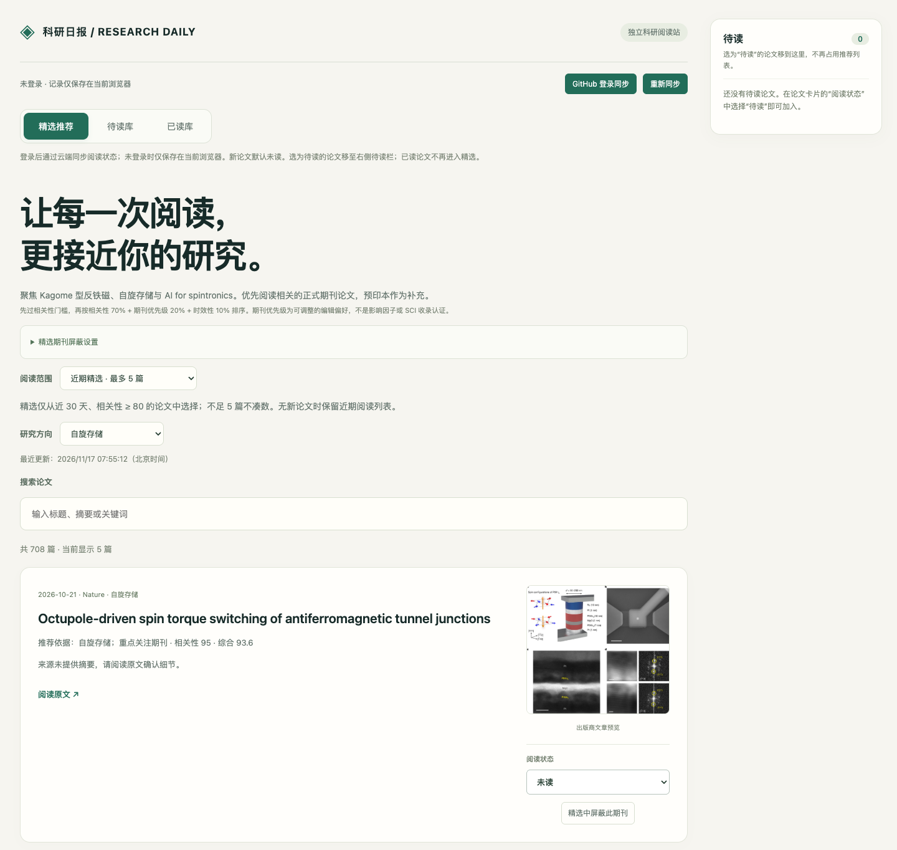
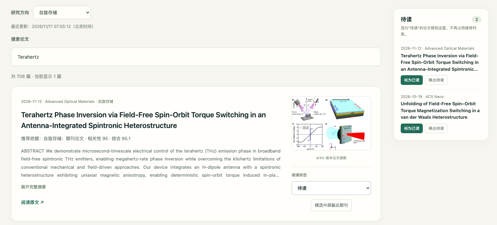

# 科研日报 · Research Daily

科研日报每天从 Crossref 和 arXiv 汇集论文，按研究方向筛选近期精选。你可以搜索标题和摘要、查看原文与论文预览图，并把感兴趣的论文加入待读库。使用 GitHub 登录后，阅读状态和精选期刊偏好可在设备间同步。

**[打开科研日报](https://andre8726.github.io/research-daily/)**

## 界面演示

**精选推荐** · 按阅读范围和研究方向筛选，浏览论文卡片与预览图。



**待读库与侧栏** · 在待读库搜索论文、展开摘要，也可以在右侧栏标为已读或移出待读。



截图来自线上站点。示例论文随每日数据更新而变化。

## 浏览与筛选

- **四个研究方向**涵盖交替磁性（`altermagnetism`）、Kagome 反铁磁、自旋存储和 AI for spintronics。
- **三种阅读范围**包括「近期精选」「全部相关论文」和「原始候选」。近期精选从近 30 天且相关性至少为 80 的论文中选出最多 5 篇。全部相关论文保留达到相关性门槛的历史条目。原始候选也纳入未通过筛选的论文。
- **关键词搜索**匹配标题、摘要和研究方向标签，可与方向筛选同时使用。论文卡片提供推荐依据、原文链接和可展开的来源摘要，标题支持上下标等科学符号格式。预印本有来源标记，摘要和图片取决于来源是否提供。
- **精选期刊屏蔽**可在「精选期刊屏蔽设置」或论文卡片上操作。被屏蔽期刊的论文仍可在相关论文和原始候选中浏览。默认屏蔽 *Journal of Magnetism and Magnetic Materials*，可随时恢复该刊的精选推荐。

## 阅读库与同步

| 阅读状态 | 网站行为 |
| --- | --- |
| 未读 | 默认状态。论文按当前筛选条件显示。 |
| 待读 | 进入「待读库」和右侧待读栏，并从推荐列表移出。可直接标为已读或移出待读。 |
| 已读 | 进入「已读库」并退出近期精选，在其他阅读范围中仍按各自条件显示。 |

未登录时，阅读状态和期刊偏好保存在当前浏览器。点击「GitHub 登录同步」，即可通过 Supabase 按账号保存和同步这些设置。登录后可点「合并本机记录」导入该浏览器的访客记录，已有云端记录优先。网络中断时，本机保留待同步的更改，恢复后可点击「重新同步」。

## 数据来源与排序

- **期刊论文**来自 Crossref 的近 90 天检索。**预印本**来自 arXiv，每个研究方向查询最多 60 条最新结果。站点累计保留去重后的收录条目，同标题时优先保留期刊版本。
- 按标题和摘要中的主题规则给出相关性分数，再按**相关性 70%、期刊优先级 20%、时效性 10%**计算综合分。期刊优先级采用可调整的关注名单，综合分用于排列阅读顺序。
- 期刊论文优先显示出版商提供的文章预览图，也可借助 Semantic Scholar 匹配 arXiv 版本。arXiv 预览取自 HTML 全文的首张插图。图片缺失时，仍可通过原文链接查看图表。

## 本地预览

用 Python 3 启动静态服务器，直接浏览仓库已收录的数据。

```bash
python3 -m http.server 8765 --bind 127.0.0.1 --directory site
```

浏览器打开 `http://127.0.0.1:8765/`。如需手动更新本地论文数据和预览图，在仓库根目录运行以下命令。

```bash
python3 scripts/update.py
python3 scripts/images.py
```

## 部署与维护

在 GitHub 仓库的 **Settings → Pages** 中将 **Source** 设为 **GitHub Actions**。推送到 `main` 会部署当前 `site/`。工作流每天北京时间 00:00（UTC 16:00）计划采集并部署，也可在 **Actions → Deploy research daily** 手动运行采集。页面显示最近一次成功的数据更新时间。

| 文件 | 用途 |
| --- | --- |
| [`site/index.html`](site/index.html) | 页面布局、推荐列表、搜索和阅读库 |
| [`site/cloud.js`](site/cloud.js) | GitHub 登录、阅读状态和期刊偏好同步 |
| [`scripts/update.py`](scripts/update.py) | 研究方向、检索式与论文数据更新 |
| [`scripts/ranking.py`](scripts/ranking.py) | 主题规则、期刊名单与综合排序 |
| [`scripts/images.py`](scripts/images.py) | 查找并缓存论文预览图链接 |
| [`.github/workflows/pages.yml`](.github/workflows/pages.yml) | 定时采集与 GitHub Pages 部署 |

如需为自己的部署启用同步，在 Supabase 启用 GitHub 登录，将 Supabase 的 Auth callback 填入 GitHub OAuth App，再将实际站点地址（含路径）加入 Supabase 的 Redirect URLs。在 `site/cloud.js` 更新项目地址、publishable key 和 `redirectTo`。 [Supabase GitHub 登录配置](https://supabase.com/docs/guides/auth/social-sign-in/auth-github) · [回调地址配置](https://supabase.com/docs/guides/auth/redirect-urls)

同步使用 `reading_states` 表，其中 `user_id` 是账号 UUID，`paper_id` 与 `status` 为文本。`(user_id, paper_id)` 组成主键，状态取值为 `unread`、`pending` 或 `read`。启用行级安全策略，允许已登录用户仅查询、插入和更新自己的记录。
